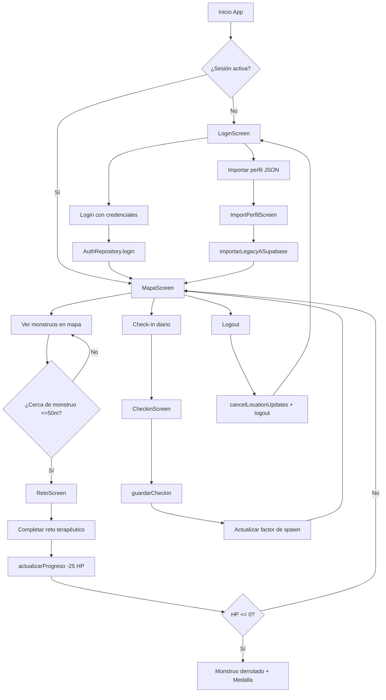

# Documentación de Aurora GO

## Índice

- [Descripción General](#descripción-general)
- [Objetivo del Proyecto](#objetivo-del-proyecto)
- [Arquitectura del Proyecto](#arquitectura-del-proyecto)
- [Modelos de Datos](#modelos-de-datos)
- [Repositorios](#repositorios)
- [Navegación](#navegación)
- [Pantallas (UI)](#pantallas-ui)
- [Utilidades](#utilidades)
- [Sistema de Mapas (Mapsforge)](#sistema-de-mapas-mapsforge)
- [Sistema de Spawn Inteligente](#sistema-de-spawn-inteligente)
- [Sistema de Reto Terapéutico](#sistema-de-reto-terapéutico)
- [Almacenamiento](#almacenamiento)
- [Autenticación y Backend](#autenticación-y-backend)
- [Trabajo en Segundo Plano](#trabajo-en-segundo-plano)
- [Recursos](#recursos)
- [Configuración y Compilación](#configuración-y-compilación)
- [Permisos Requeridos](#permisos-requeridos)
- [Flujo de Usuario](#flujo-de-usuario)
- [Consideraciones de Seguridad](#consideraciones-de-seguridad)
- [Estado del Proyecto](#estado-del-proyecto)
- [Roadmap](#roadmap)
- [Licencia](#licencia)

## Descripción General

**Aurora GO** es una aplicación móvil Android gamificada para el trabajo emocional. Inspirada en juegos como Pokémon GO, permite a los usuarios encontrar y enfrentar "monstruos" que representan sus miedos o emociones difíciles en un mapa real, utilizando retos psicológicos terapéuticos para superarlos.

> ⚠️ **Importante:** Es un complemento de bienestar emocional, no sustituye la ayuda profesional.

## Objetivo del Proyecto

Transformar el trabajo emocional en una experiencia interactiva y motivadora mediante:
- **Gamificación**: Monstruos en mapa real, sistema de HP, medallas al derrotarlos
- **Terapia breve**: Retos específicos para cada tipo de miedo/emoción
- **Conciencia emocional**: Check-in diario que influye en la aparición de monstruos
- **Persistencia**: Progreso guardado localmente y en la nube
- **Offline-first**: Soporte para mapas sin conexión

## Arquitectura del Proyecto

El proyecto sigue una arquitectura modular basada en **MVVM** con **Jetpack Compose**.

```
app/src/main/java/com/efrix/aurorago/
├── data/           # Capa de datos
│   ├── model/      # Modelos de datos (entidades)
│   ├── repository/ # Repositorios (lógica de negocio)
│   └── supabase/   # Configuración de cliente Supabase
├── ui/             # Capa de presentación
│   ├── navigation/ # Rutas de navegación
│   ├── screens/    # Pantallas Compose
│   └── theme/      # Tema Material 3
├── util/           # Utilidades y helpers
└── MainActivity.kt # Punto de entrada
```

### Patrones Utilizados

- **Singletons**: `AuthRepository`, `SupabaseClient.instance` para acceso global
- **Repository Pattern**: Abstracción de fuentes de datos (Supabase + archivos locales)
- **StateFlow**: Para observar estado reactivo (usuario actual)
- **EncryptedFile**: Cifrado de datos sensibles locales con Jetpack Security
- **WorkManager**: Tareas en segundo plano
- **Navigation Compose**: Navegación entre pantallas

## Modelos de Datos

### Clases Base

#### `Miedo` (Clase abierta)
```kotlin
open class Miedo(
    open val tipo: String,
    open val intensidad: Int,
    open val contexto: String = ""
)
```
Clase base para representar un miedo/emoción.

#### `MiedoEnMapa` (Data class)
```kotlin
data class MiedoEnMapa(
    val id: String,
    override val tipo: String,
    override val intensidad: Int,
    override val contexto: String = "",
    val latitud: Double,
    val longitud: Double,
    val hp: Int = 100
) : Miedo(tipo, intensidad, contexto)
```
Representa un monstruo generado en el mapa con ubicación geográfica y puntos de vida.

### Modelos Legacy (para importación)

#### `PerfilLegacy`
```kotlin
data class PerfilLegacy(
    val nombreUsuario: String,
    val edad: Int?,
    val miedos: List<MiedoLegacy>,
    val consentimiento: Boolean,
    val fechaCreacion: String,
    var progreso: MutableMap<String, Int> = mutableMapOf()
)
```
Estructura para importar perfiles desde archivos JSON legacy.

#### `MiedoLegacy`
```kotlin
data class MiedoLegacy(
    val tipo: String,
    val intensidad: Int,
    val contexto: String = ""
)
```

#### `CheckinLegacy` / `EmocionCheckinLegacy`
```kotlin
data class CheckinLegacy(
    val fecha: String,            // Formato YYYY-MM-DD
    val emociones: List<EmocionCheckinLegacy> = emptyList(),
    val nota: String = ""
)

data class EmocionCheckinLegacy(
    val tipo: String,             // "sombra_social", "nube_tormenta", etc.
    val intensidadSentida: Int    // Rango 1..5
)
```

### Modelos de Supabase

Ver `app/src/main/java/com/efrix/aurorago/data/model/SupabaseModels.kt` para las entidades mapeadas a las tablas de Supabase (`Perfil`, `MiedoData`, `ProgresoMiedo`, `Checkin`, `ProgresoMiedoUpdate`).

## Repositorios

### `AuthRepository` (Singleton)

Gestiona autenticación, perfil y progreso con Supabase.

**Propiedades:**
- `currentUser: StateFlow<UserSession?>` - Sesión activa del usuario
- `_progressListeners: CopyOnWriteArrayList<(Map<String, Int>) -> Unit>` - Listeners para cambios de progreso

**Métodos principales:**

| Método | Descripción |
| --- | --- |
| `login(email, password): Result<Unit>` | Inicia sesión con email/contraseña via Supabase Auth |
| `logout()` | Cierra sesión, limpia datos locales |
| `getPerfil(): Perfil?` | Obtiene perfil del usuario desde Supabase |
| `actualizarNombreUsuario(nuevoNombre): Result<Unit>` | Actualiza nombre de usuario |
| `getProgresoMiedos(): Map<String, Int>` | Obtiene mapa `miedo_id -> hp_restante` |
| `actualizarProgreso(miedoId, hpRestante, onProgressUpdated): Boolean` | Actualiza HP tras reto. Retorna `true` si HP <= 0 (derrotado) |
| `guardarCheckin(fecha, respuestas, nota)` | Guarda check-in diario en Supabase |
| `obtenerCheckinHoy(fecha): Map<String, Int>?` | Obtiene respuestas del check-in de hoy |
| `restoreSession()` | Restaura y valida sesión guardada |
| `actualizarUbicacionBackground(lat, lon)` | Actualiza ubicación del usuario en segundo plano |
| `importarLegacyASupabase(nombreUsuario, edad, miedos, progresoLocal): Result<Unit>` | Migra perfil legacy a Supabase |

**Características:**
- Logging condicional (`BuildConfig.DEBUG`)
- Notificación a listeners tras actualizar progreso
- Manejo robusto de errores de sesión
- Formateo de fechas ISO 8601 para `updated_at`

### `PerfilRepository` (Instanciado con Context)

Gestiona persistencia local cifrada con archivos JSON.

**Archivos gestionados:**
- `perfil.json` - Perfil legacy y progreso
- `checkins.json` - Histórico de check-ins

**Métodos principales:**

| Método | Descripción |
| --- | --- |
| `guardarPerfil(perfil: PerfilLegacy)` | Guarda perfil cifrado. Fallback a sin cifrar si falla |
| `cargarPerfil(): PerfilLegacy?` | Carga perfil con migración automática |
| `guardarProgreso(miedoId, nuevoHp)` | Actualiza HP de un miedo en perfil local |
| `cargarProgreso(miedoId): Int` | Obtiene HP (default 100 si no existe) |
| `existePerfil(): Boolean` | Verifica existencia de perfil local |
| `guardarCheckin(checkin: Checkin)` | Guarda/actualiza check-in (upsert por fecha) |
| `cargarCheckinHoy(): Checkin?` | Obtiene check-in del día actual |
| `obtenerFactorSpawn(tipoMiedo: String): Float` | Calcula factor de spawn basado en intensidad reportada |

**Cifrado:**
- Usa `MasterKey` con esquema `AES256_GCM`
- `EncryptedFile.FileEncryptionScheme.AES256_GCM_HKDF_4KB`
- Migración automática de archivos sin cifrar a cifrados
- Fallback robusto ante fallos de cifrado

## Navegación

### `Rutas` 
```kotlin
object Rutas {
    const val LOGIN = "login"
    const val IMPORTAR_PERFIL = "importar_perfil"
    const val MAPA = "mapa"
    const val RETO = "reto/{tipoMiedo}/{miedoId}"
    const val CHECKIN = "checkin"
}
```

### Flujo de navegación en `MainActivity`

1. **Inicio**: `LOGIN`
2. **Login exitoso** → `MAPA` (limpia backstack)
3. **Importar perfil** desde Login → `IMPORTAR_PERFIL`
4. **Importación exitosa** → `MAPA` (limpia backstack)
5. **Click en monstruo** → `RETO/{tipoMiedo}/{miedoId}`
6. **Click check-in** → `CHECKIN` (push)
7. **Logout** → `LOGIN` (limpia backstack, cancela `LocationWorker`)

## Pantallas (UI)

### `LoginScreen`
Pantalla de autenticación con email/contraseña. Ofrece opción para importar perfil legacy desde JSON.

### `ImportPerfilScreen`
Importador de perfiles legacy. Permite cargar archivo JSON con estructura `PerfilLegacy` y migrarlo a Supabase.

### `MapaScreen`
Pantalla principal con mapa interactivo Mapsforge.

**Funcionalidades:**
- Renderizado de mapa con tiles offline
- Marcadores de monstruos (`MiedoEnMapa`)
- Ubicación del usuario con `FusedLocationProviderClient`
- Generación dinámica de monstruos basada en spawn inteligente
- Botón para acceder a check-in diario
- Logout
- Navegación a retos al tocar monstruo

### `RetoScreen`
Pantalla para enfrentar un monstruo con reto terapéutico específico.

**Tipos de retos por emoción:**

| Tipo de Miedo | Emoción | Descripción del Reto |
| --- | --- | --- |
| `sombra_social` / `ansiedad_social` | Ansiedad social | Elegir la respuesta más positiva en un test |
| `nube_tormenta` / `frustracion` | Frustración/Ira | Realizar una respiración guiada |
| `niebla_gris` / `tristeza` | Tristeza | Tomar una foto de algo que te dé gratitud (CameraX) |
| `reloj_tembloroso` / `miedo_fracaso` | Miedo al fracaso | Escribir un logro reciente |

**Mecánica:**
- Cada reto superado resta 25 HP al monstruo
- Al llegar a 0 HP, el miedo se considera derrotado y se gana una medalla
- Progreso se guarda en Supabase y localmente

### `CheckinScreen`
Pantalla de check-in diario.

**Funcionalidades:**
- Registro de intensidad emocional por tipo (escala 1-5)
- Campo opcional de nota
- Guarda en Supabase y localmente
- Influye directamente en el factor de spawn de monstruos

## Utilidades

### `MapStateHolder` (Singleton)
Gestiona el estado del mapa para evitar fugas de memoria.

Centraliza:
- Estado de `MapView`
- Marcadores de monstruos
- Posición del usuario
- Estado de carga

### `MapaInitializer` / `inicializarMapsforge()`
Inicializa el motor Mapsforge antes de renderizar el mapa en `MainActivity`.

### `LocationWorker` (WorkManager)
Worker para actualizaciones de ubicación en segundo plano.

**Funcionalidades:**
- Actualiza ubicación periódicamente
- Sincroniza con Supabase via `AuthRepository.actualizarUbicacionBackground()`
- Método estático `cancelLocationUpdates(context)` para cancelar trabajo

### `SpritesSheetHelper`
Helper para gestionar sprites animados de los monstruos.

Carga y gestiona hojas de sprites (`drawable-nodpi/`) para renderizar monstruos animados con diferentes estados.

## Sistema de Mapas (Mapsforge)

**Tecnología:** Mapsforge VTM (Vector Tile Maps) para Android

**Características:**
- **Sin Google Play Services para mapas**: Usa tiles vectoriales propios
- **Ligero y offline-capable**: Preparado para mapas descargados
- **Renderizado custom**: Control total sobre marcadores y capas
- **Integración con ubicación**: Usa `FusedLocationProviderClient` de Google Play Services

**Dependencias:**
```kotlin
implementation(libs.mapsforge.map.android)
implementation(libs.mapsforge.map)
implementation(libs.mapsforge.core)
implementation("com.google.android.gms:play-services-location:21.3.0")
implementation("org.jetbrains.kotlinx:kotlinx-coroutines-play-services:1.9.0")
```

## Sistema de Spawn Inteligente

El spawn de monstruos se adapta dinámicamente al estado emocional del usuario.

### Lógica

1. **Check-in diario**: Usuario reporta intensidad (1-5) por tipo de emoción
2. **Factor de spawn**: `PerfilRepository.obtenerFactorSpawn(tipoMiedo)` calcula factor
   ```kotlin
   fun obtenerFactorSpawn(tipoMiedo: String): Float {
       val checkin = cargarCheckinHoy() ?: return 1.0f
       val intensidad = checkin.respuestas[tipoMiedo]
       return if (intensidad != null) {
           1.0f + (intensidad - 3) * 0.3f  // Intensidad 3 = factor 1.0
       } else 1.0f
   }
   ```
3. **Aplicación**: Más intensidad emocional → mayor probabilidad/cantidad de monstruos de ese tipo
4. **Actualización periódica**: `LocationWorker` regenera monstruos en segundo plano

**Ejemplos:**
- Intensidad 1 (muy baja): factor = 1.0 + (1-3)*0.3 = 1.0 - 0.6 = 0.4 (menos monstruos)
- Intensidad 3 (neutral): factor = 1.0 (normal)
- Intensidad 5 (muy alta): factor = 1.0 + (5-3)*0.3 = 1.0 + 0.6 = 1.6 (más monstruos)

## Sistema de Reto Terapéutico

### Mecánica de Combate

- **HP Inicial**: 100 por monstruo
- **Daño por reto**: 25 HP al completar correctamente
- **Derrota**: Al alcanzar 0 HP (4 retos completados)
- **Recompensa**: Medalla al derrotar
- **Persistencia**: HP guardado en Supabase (`progreso_miedos`) y actualizado localmente

### Retos Específicos

#### 1. Sombra del Juicio (Ansiedad Social)
- **Tipo**: Test de elección múltiple
- **Objetivo**: Elegir la respuesta más positiva/autocompasiva
- **Terapia**: Reestructuración cognitiva

#### 2. Nube de Tormenta (Frustración/Ira)
- **Tipo**: Respiración guiada
- **Objetivo**: Seguir ejercicio de respiración
- **Terapia**: Regulación emocional

#### 3. Niebla Gris (Tristeza)
- **Tipo**: Fotografía con gratitud
- **Objetivo**: Tomar foto de algo que genere gratitud
- **Tecnología**: CameraX
- **Terapia**: Atención plena y gratitud

#### 4. Reloj Tembloroso (Miedo al Fracaso)
- **Tipo**: Escritura reflexiva
- **Objetivo**: Escribir un logro reciente
- **Terapia**: Autoeficacia y enfoque en logros

## Almacenamiento

### Híbrido: Nube + Local

#### Supabase (Nube)
**Tablas utilizadas:**
- `perfiles` - Datos de perfil del usuario
- `progreso_miedos` - HP restante por miedo (clave compuesta `usuario_id,miedo_id`)
- `checkins` - Check-ins diarios con respuestas JSON

**Características:**
- Row Level Security (RLS) habilitado
- Autenticación con Supabase Auth
- Sincronización en tiempo real

#### Local (Dispositivo)
**Ubicación:** `context.filesDir/`

- `perfil.json` (cifrado) - Perfil legacy + progreso local
- `checkins.json` (cifrado) - Histórico de check-ins

**Seguridad:**
- Cifrado AES256_GCM con `AndroidX Security Crypto`
- Migración automática
- Fallback a texto plano solo en caso de fallo crítico

## Autenticación y Backend

### Supabase Configuration

**Cliente:** `supabase-kt` v2.0.0

**Módulos:**
```kotlin
implementation("io.github.jan-tennert.supabase:supabase-kt:2.0.0")
implementation("io.github.jan-tennert.supabase:gotrue-kt:2.0.0")      // Auth
implementation("io.github.jan-tennert.supabase:postgrest-kt:2.0.0")   // Database
implementation("io.ktor:ktor-client-android:2.3.11")                  // HTTP engine
implementation("org.jetbrains.kotlinx:kotlinx-serialization-json:1.6.0")
```

**Configuración:**
- Credenciales en `BuildConfig.SUPABASE_URL` y `BuildConfig.SUPABASE_ANON_KEY`
- Cargadas desde `local.properties` (ver [Configuración](#configuración-y-compilación))
- Ver `app/src/main/java/com/efrix/aurorago/data/supabase/SupabaseClient.kt`

**Flujo de Auth:**
1. Login con `supabase.auth.signInWith(Email)`
2. Sesión almacenada automáticamente por supabase-kt
3. `restoreSession()` valida sesión al iniciar app
4. Logout con `signOut()` + `clearSession()`

## Trabajo en Segundo Plano

### WorkManager

**Dependencia:** `androidx.work:work-runtime-ktx:2.9.1`

**`LocationWorker`:**
- Worker periódico para actualizaciones de ubicación
- Llama a `AuthRepository.actualizarUbicacionBackground()`
- Actualiza posición del usuario en Supabase
- Regenera monstruos basado en nueva ubicación
- Se cancela en logout via `LocationWorker.cancelLocationUpdates()`

## Recursos

### Sprites y Gráficos
- `res/drawable-nodpi/` - Hojas de sprites de monstruos
- `res/drawable/` - Iconos y drawables generales
- `res/mipmap-*/` - Iconos de la app

### Valores
- `res/values/` - Strings, colores, temas
- `res/xml/` - Configuraciones XML

## Configuración y Compilación

### Requisitos

- **Android Studio**: Jellyfish o superior
- **JDK**: 17
- **Min SDK**: 26 (Android 7.0)
- **Target/Compile SDK**: 36
- **Kotlin**: Con Kotlin Compose Compiler Plugin

### Configuración de Credenciales

Crear archivo `local.properties` en la raíz del proyecto:

```properties
SUPABASE_URL=https://tu-proyecto.supabase.co
SUPABASE_ANON_KEY=tu-clave-anon-publica
```

**Importante:** Nunca commitear `local.properties` al repositorio. Está en `.gitignore`.

### Build Configuration

**app/build.gradle.kts:**
- `buildConfig = true` - Habilita `BuildConfig`
- `compose = true` - Habilita Jetpack Compose
- `minifyEnabled = true` (release) - Ofuscación con ProGuard
- `shrinkResources = true` (release) - Eliminación de recursos no usados
- Java 11 compatibility

### Compilar

```bash
# Debug
./gradlew assembleDebug

# Release
./gradlew assembleRelease
```

## Permisos Requeridos

El proyecto requiere los siguientes permisos (verificar en `AndroidManifest.xml`):

| Permiso | Uso |
| --- | --- |
| `ACCESS_FINE_LOCATION` | Ubicación precisa para mapa y spawn de monstruos |
| `ACCESS_COARSE_LOCATION` | Ubicación aproximada como fallback |
| `CAMERA` | Reto de gratitud fotográfica |
| `INTERNET` | Comunicación con Supabase |
| `ACCESS_NETWORK_STATE` | Verificación de conectividad |

## Flujo de Usuario



## Consideraciones de Seguridad

- **Credenciales**: Supabase keys en `BuildConfig` (no hardcodeadas), cargadas desde `local.properties`
- **Datos locales cifrados**: `perfil.json` y `checkins.json` con AES256_GCM
- **Autenticación**: Gestionada por Supabase Auth con sesiones seguras
- **RLS**: Row Level Security en Supabase para proteger datos por usuario
- **ProGuard/R8**: Habilitado en release para ofuscación
- **Migración segura**: Archivos sin cifrar se migran automáticamente al cifrado
- **Validación de sesión**: `restoreSession()` valida con servidor

## Estado del Proyecto

**Fase:** Consolidación de arquitectura

### Avances Recientes

- ✅ **Centralización de configuración**: Uso de `BuildConfig` para credenciales de Supabase
- ✅ **Importador de Perfiles**: Pantalla para cargar datos legacy mediante JSON
- ✅ **Lógica de Spawn Dinámica**: Factor multiplicador basado en check-in diario
- ✅ **Refactorización de Mapas**: `MapStateHolder` para gestión de estado limpia
- ✅ **Cifrado local**: Implementación de Jetpack Security Crypto
- ✅ **Migración de arquitectura**: Repositorios centralizados

## Roadmap

### Próximos Pasos

| Prioridad | Feature | Descripción |
| --- | --- | --- |
| Alta | **Optimización de Sprites** | Sistema de renderizado de frames más eficiente para monstruos en mapa |
| Alta | **Sistema de Logros** | Galería de medallas persistente para motivar progreso a largo plazo |
| Media | **Mapas Offline** | Implementación de descarga de archivos `.map` para funcionamiento total sin conexión |
| Media | **Notificaciones Push** | Recordatorios inteligentes para check-in diario basados en inactividad |
| Media | **Feedback Visual** | Mejorar animaciones de transición entre mapa y retos |

## Licencia

Distribuido bajo la **Licencia MIT**. Ver archivo `LICENSE` para más detalles.

---

**Última actualización:** 22 de junio de 2026  

**Versión:** 1.0  
**Package:** `com.efrix.aurorago`  
**Desarrollado con:** Kotlin, Jetpack Compose, Mapsforge, Supabase
