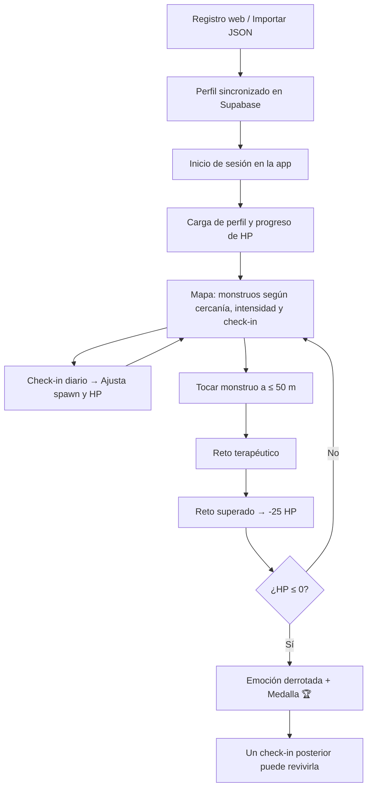

# 🛡️ Aurora GO

**Aurora GO** es una aplicación móvil Android que transforma el trabajo emocional en una experiencia interactiva y gamificada. Inspirada en juegos como Pokémon GO, Aurora GO te invita a salir a la calle, encontrar criaturas que representan tus miedos o emociones difíciles, y combatirlas mediante pequeños retos psicológicos.

> 🌱 **Complemento de bienestar emocional** – No sustituye la ayuda profesional.

---

## 📖 Descripción

Cada usuario crea un perfil en una **página web** donde selecciona sus emociones predominantes (por ejemplo, ansiedad social, frustración, tristeza o miedo al fracaso), asigna una intensidad (1‑5) y escribe un contexto opcional. Luego, al iniciar sesión en la app, esas emociones se convierten en **monstruos animados** que aparecen en un mapa real alrededor de la ubicación del usuario.

Al acercarte a uno de ellos (≤ 50 m), puedes **enfrentarlo** a través de un reto específico:

- **Sombra del Juicio** (ansiedad social): elegir la respuesta más positiva en un test.
- **Nube de Tormenta** (frustración/ira): realizar una respiración guiada.
- **Niebla Gris** (tristeza): tomar una foto de algo que te dé gratitud.
- **Reloj Tembloroso** (miedo al fracaso): escribir un logro reciente.

Cada reto superado resta 25 HP al monstruo; al llegar a 0 HP, el miedo se considera **derrotado** y se gana una medalla. Además, la app cuenta con un **check-in diario** donde el usuario reporta la intensidad de sus emociones: esto influye en la frecuencia de aparición de cada tipo de monstruo y también en su HP (reportar una intensidad alta recupera vida; una emoción derrotada puede "revivir" si vuelve a aparecer en el check-in).

---

## 🎯 Características principales

- **Inicio de sesión** con email/contraseña a través de Supabase. La creación de cuenta se realiza desde la web oficial ([aurora-go.netlify.app](https://aurora-go.netlify.app/)).
- **Perfil personalizado** con lista de miedos y progreso persistente (HP restante por cada tipo).
- **Overlay de perfil en el mapa**: nombre editable, email, barras de HP por emoción y contador de emociones derrotadas.
- **Importación de perfiles** desde JSON legacy, ya sea seleccionando un archivo o pegando el contenido, con sincronización automática a Supabase.
- **Mapa interactivo** basado en **Mapsforge** con tiles de OpenStreetMap (Mapnik) y caché local para acelerar la carga.
- **Monstruos animados** con hojas de sprites (spritesheets) animadas frame a frame, tanto en el mapa como en la pantalla de check-in.
- **Renderizado optimizado en el mapa**: una única capa (`MonstruosLayer`) dibuja todos los monstruos, reutiliza frames cacheados, descarta lo que queda fuera de pantalla y soporta rotación del mapa.
- **Sistema de Spawn Inteligente**: la cantidad de monstruos de cada tipo se ajusta según la intensidad del perfil y la intensidad reportada en el check-in diario, con mayor densidad cerca del jugador.
- **Check-in diario con impacto en HP**: cada nivel de intensidad reportado recupera 10 HP (máx. 100) y puede revivir una emoción derrotada; además actualiza la intensidad y el contexto del perfil.
- **Validación de proximidad**: solo se puede entrar al reto si el monstruo está a 50 m o menos; se muestra la distancia y el HP restante.
- **Consentimiento de ubicación en segundo plano** y actualización periódica mediante **WorkManager** (cada 15 minutos y con conexión a red).
- **Persistencia híbrida y cifrada**: Supabase para la nube y archivos JSON locales cifrados con AES256_GCM para acceso offline.
- **Interfaz moderna** con **Jetpack Compose** y **Material 3**.

---

## 🧰 Tecnologías utilizadas

- **Lenguaje**: Kotlin
- **UI**: Jetpack Compose + Material 3 + Navigation Compose
- **Estado**: ViewModel + StateFlow
- **Mapas**: Mapsforge (VTM) con capa de descarga de tiles de OpenStreetMap y caché local.
- **Backend**: Supabase (Auth, PostgREST, RLS)
- **Cliente Supabase**: `supabase-kt` + Ktor para la comunicación asíncrona.
- **Localización**: FusedLocationProviderClient (Google Play Services).
- **Trabajo en segundo plano**: Android WorkManager.
- **Serialización**: kotlinx.serialization (Supabase) + Gson (JSON local).
- **Cámara**: CameraX para el reto de gratitud visual.
- **Seguridad local**: Jetpack Security Crypto (`EncryptedFile`, AES256_GCM).

---

## 🗂️ Estructura del proyecto (resumen)

```
app/
├── src/main/java/com/efrix/aurorago/
│   ├── data/
│   │   ├── model/           # Perfil, Miedo, MiedoEnMapa, Checkin y modelos Supabase
│   │   ├── repository/      # AuthRepository y PerfilRepository
│   │   └── supabase/        # Cliente Supabase
│   ├── ui/
│   │   ├── navegation/      # Rutas de navegación
│   │   ├── screens/         # login, mapa, reto, checkin, importarperfil
│   │   └── theme/           # Sistema de diseño Material 3
│   ├── util/                # SpritesheetHelper, MapStateHolder, MapaInitializer, LocationWorker
│   └── MainActivity.kt      # Orquestador de navegación
├── res/                     # Recursos visuales (Sprites, Iconos, Drawables)
└── build.gradle.kts         # Gestión de dependencias y configuración de compilación
```

> 📚 Para el detalle de arquitectura, modelos y flujos internos, consulta [`Documentación.md`](Documentación.md).

---

## ⚙️ Configuración y ejecución

### Prerrequisitos

- Android Studio Jellyfish (o superior)
- JDK 17
- Dispositivo o emulador con Android 8.0 (API 26) o superior
- Cuenta en Supabase configurada.

### Variables de entorno

El proyecto utiliza `BuildConfig` para gestionar las credenciales de Supabase de forma segura. Asegúrate de configurar las siguientes propiedades en tu archivo `local.properties` (en la raíz del proyecto):

```properties
SUPABASE_URL=https://tu-proyecto.supabase.co
SUPABASE_ANON_KEY=tu-clave-anon-publica
```

*Nota: No es recomendable hardcodear estas claves directamente en el código fuente ni subir `local.properties` al repositorio.*

---

## 🔄 Flujo de trabajo



---

## 📊 Estado actual

El proyecto se encuentra en una fase de **consolidación y pulido de la experiencia**. La arquitectura está centralizada en repositorios y el mapa funciona con una capa de renderizado propia y eficiente.

**Últimos avances**:
- ✅ **Sistema de sprites animados**: hojas de sprites animadas frame a frame en el mapa y en el check-in.
- ✅ **Optimización del mapa**: `MonstruosLayer` unifica el dibujado de monstruos, reutiliza frames cacheados, aplica culling y evita fugas de memoria.
- ✅ **Check-in con impacto en HP**: la intensidad reportada recupera vida y puede revivir emociones derrotadas; también actualiza el contexto del perfil.
- ✅ **Perfil integrado en el mapa**: overlay con nombre editable, email, progreso por emoción y contador de derrotados.
- ✅ **Consentimiento de ubicación en segundo plano**: diálogo explícito antes de programar `LocationWorker`.
- ✅ **Importador de perfiles**: carga desde archivo JSON o texto pegado, con sincronización a Supabase.
- ✅ **Persistencia local cifrada**: `perfil.json` y `checkins.json` protegidos con AES256_GCM y migración automática de archivos antiguos.
- ✅ **Configuración centralizada**: credenciales de Supabase cargadas mediante `BuildConfig`.
- ✅ **Lógica de Spawn Dinámica**: combinación de intensidad del perfil, factor del check-in y agrupación cerca del jugador.
- ✅ **Robustez del mapa**: `SafeMapsforgeView` evita operaciones sobre el `MapView` antes de estar listo y `MapStateHolder` conserva el estado entre navegaciones.

---

## 🚀 Próximos pasos

- **Galería de medallas persistente**: convertir el mensaje de victoria actual en una colección de logros consultable.
- **Mapas offline**: implementar la descarga de archivos `.map` para funcionamiento total sin conexión (hoy se usan tiles online con caché).
- **Historial de check-ins**: pantalla para consultar los registros diarios ya almacenados localmente.
- **Notificaciones Push**: recordatorios inteligentes para el check-in diario basados en la inactividad del usuario.
- **Feedback visual**: mejorar las animaciones de transición entre el mapa y los retos.

---

## 🤝 Contribuciones

Si deseas contribuir, puedes abrir un **issue** para discutir cambios o enviar un **pull request**.

---

## 📜 Licencia

Distribuido bajo la licencia **MIT**. Consulta el archivo `LICENSE` para más detalles.

---

*Última actualización: 3 de noviembre de 2026*
